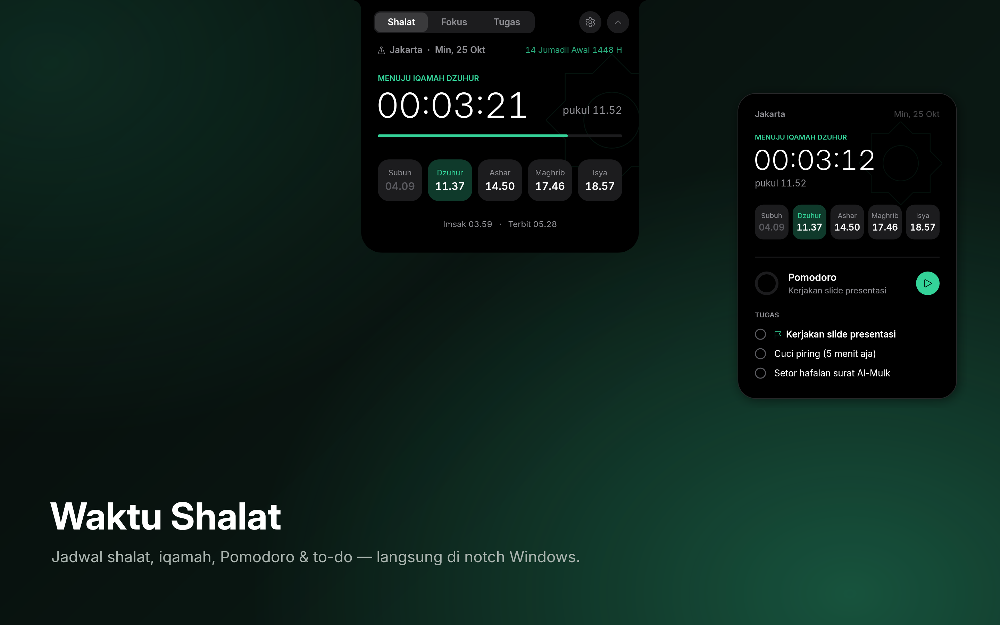
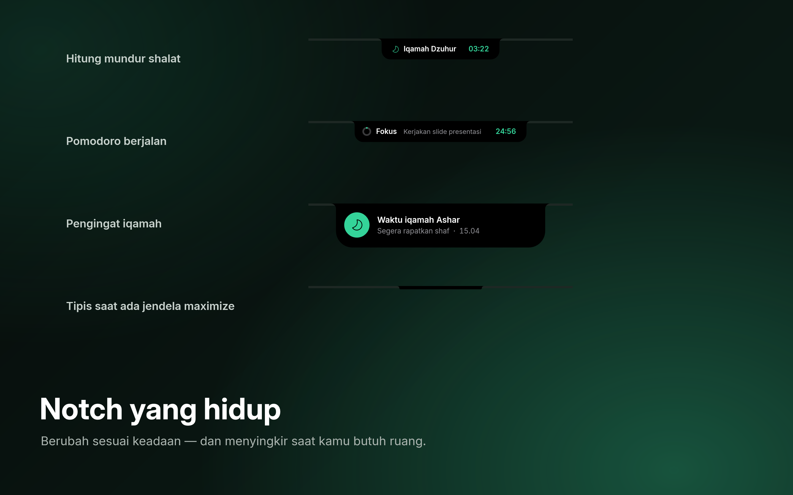
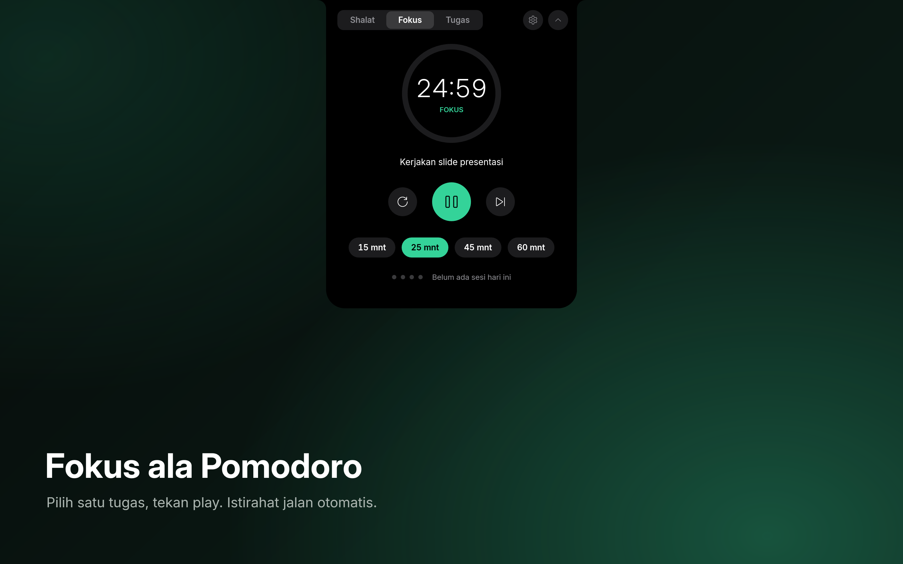
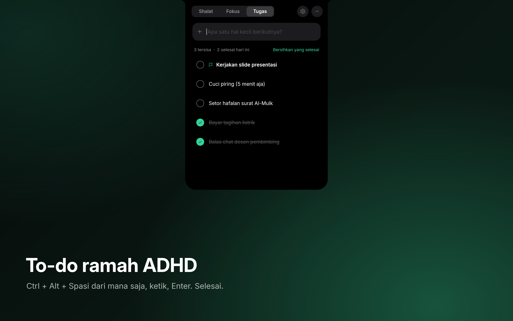
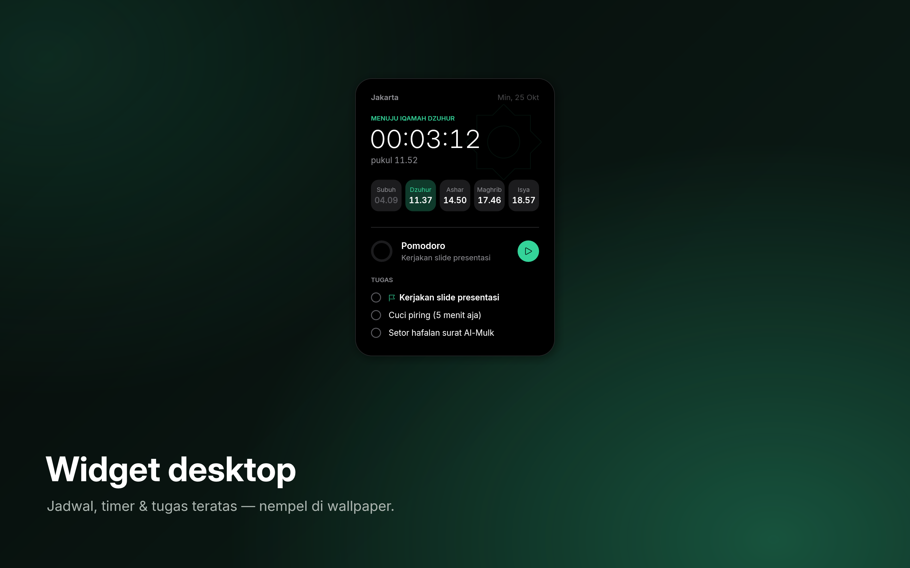

# Waktu Shalat

Jadwal shalat, Pomodoro, dan to-do — langsung di **notch** Windows. Hitam pekat, gaya Apple, ringan (±3 MB).



## Unduh

**[⬇ WaktuShalat-Setup.exe](https://github.com/farishiddiq/waktu-shalat/releases/latest/download/WaktuShalat-Setup.exe)** — Windows 10/11, tanpa admin.

> Installer belum ditandatangani, jadi Windows SmartScreen mungkin menampilkan peringatan. Klik **More info → Run anyway**.

## Fitur

**Notch yang hidup** — menempel di tepi atas layar, menampilkan hitung mundur ke shalat berikutnya. Arahkan mouse ke notch dan dia memanjang dengan animasi spring.



- **Jadwal shalat** dari [Aladhan API](https://aladhan.com/prayer-times-api), metode Kemenag RI (bisa diganti), 34 kota Indonesia + Makkah, Madinah, KL, Singapura. Tetap tampil saat offline.
- **Notifikasi** saat masuk waktu dan 10 menit sebelumnya, dengan chime lembut.
- **Iqamah** — setelah azan, notch menghitung mundur ke iqamah (15 menit, Maghrib 10 menit) dan mengingatkan saat waktunya tiba.
- **Menyingkir sendiri** — jadi garis tipis saat ada jendela maximize (tab Chrome tetap bisa diklik), hilang saat aplikasi fullscreen. Posisi bisa kiri, tengah, atau kanan.



- **Pomodoro** 15 / 25 / 45 / 60 menit, istirahat 5 menit dan 15 menit tiap 4 sesi. Istirahat mulai otomatis, sesi fokus menunggu kamu.



- **To-do ramah ADHD** — `Ctrl + Alt + Spasi` dari aplikasi mana pun untuk mencatat cepat. Tandai satu tugas sebagai fokus dan Pomodoro langsung jalan. Centang dapat animasi + chime kecil.



- **Widget desktop** (opsional) — jadwal, timer, dan tugas teratas, menempel di belakang semua jendela.

## Build dari source

Tidak perlu install apa pun — cukup compiler .NET Framework bawaan Windows:

```powershell
powershell -ExecutionPolicy Bypass -File .\build.ps1
```

Hasilnya `dist\WaktuShalat.exe` dan `dist\WaktuShalat-Setup.exe`. Installer mendukung `/S` (silent), `/run`, dan `/uninstall`.

## Lisensi

Kode: [MIT](LICENSE). Font [Inter](https://rsms.me/inter/) oleh Rasmus Andersson, [SIL Open Font License](src/fonts/LICENSE.txt).
